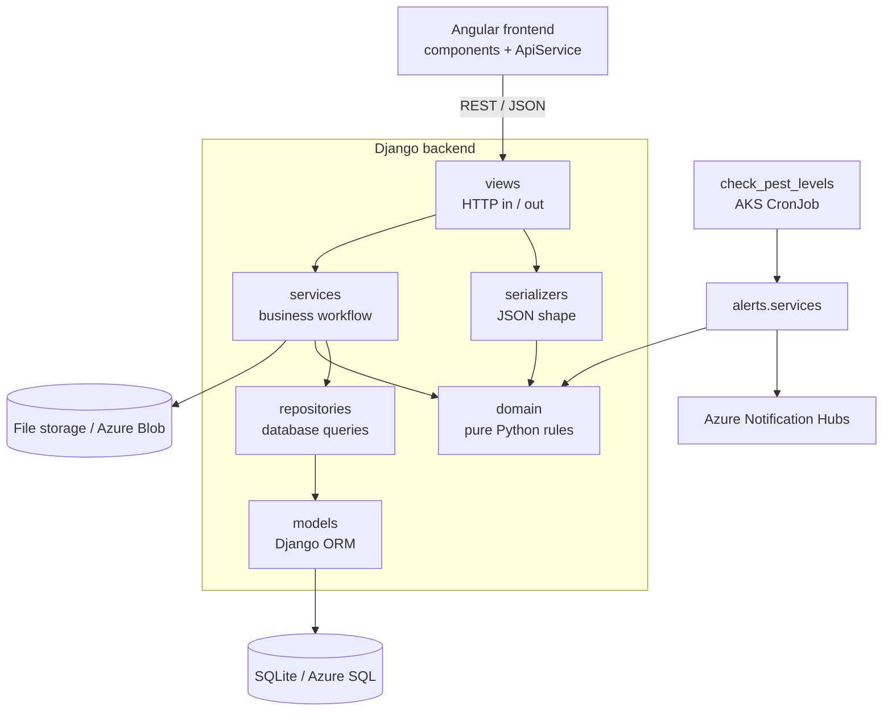

# Architecture and design patterns

## Layers

| Layer | Folder | Job | Knows about |
|---|---|---|---|
| Domain | `backend/domain/` | Business rules: validation, alert thresholds, photo cleaning, token checks, GeoJSON | Only Python + Pillow + PyJWT |
| Models | `*/models.py` | Tables (Task 5 data model) | Django ORM |
| Repositories | `sightings/repositories.py` | Every database query for sightings | Models |
| Services | `sightings/services.py`, `alerts/services.py` | Workflows: submit, attach photo, review, threshold check | Domain, repositories |
| Serializers | `*/serializers.py` | Converting JSON to/from Python | Models, domain |
| Views | `*/views.py` | HTTP: permissions, status codes | Services, serializers |

import-linter checks these rules on every build (see [CODE-QUALITY.md](CODE-QUALITY.md)).

## Design patterns used

| Pattern | Where | Why |
|---|---|---|
| **MVC / MTV** | Django models, views, serializers; Angular components and templates | Separates data, logic and presentation |
| **Repository / DAO** | `sightings/repositories.py` | Services never write queries, so the database can change (SQLite → Azure SQL) without touching business logic |
| **Service layer** | `sightings/services.py`, `alerts/services.py` | Business workflows in one place, reused by the API and the management command |
| **Domain model independent of the framework** | `backend/domain/` | Rules are unit tested in milliseconds without a database |
| **Adapter** | `frontend/src/app/core/azure-maps.ts` | Wraps the Azure Maps SDK behind a small `MapHandle` interface; the SDK only loads when a key is configured |
| **Strategy** | `alerts/senders.py` (`ConsoleSender` / `NotificationHubSender`) | Same alert code locally and in Azure; the sender is picked by settings |
| **Dependency injection** | Angular `inject(ApiService)`; services accept a `sender` parameter | Tests swap in fakes |
| **Data binding** | Angular reactive forms and signals | The form state drives the UI |

## Security built in (Task 4)

* No passwords are stored. Users sign in with Microsoft Entra ID. Tokens are checked for signature, audience, issuer and expiry (`domain/identity.py`).
* Roles come from Entra ID app roles (`User`, `Worker`, `PestControlExpert`, `Surveyor`, `Admin`) and are checked on every request (`accounts/permissions.py`).
* Photos are re-encoded, which removes GPS and other metadata. Only JPG/PNG up to 10 MB is accepted.
* The public map rounds positions to about 100 m and only shows reviewed sightings.
* Anonymous requests are rate-limited (60 per hour by default).
* Secrets come from environment variables / Key Vault, never from the code. HTTPS-only cookies and HSTS are on when `DJANGO_DEBUG=false`.
