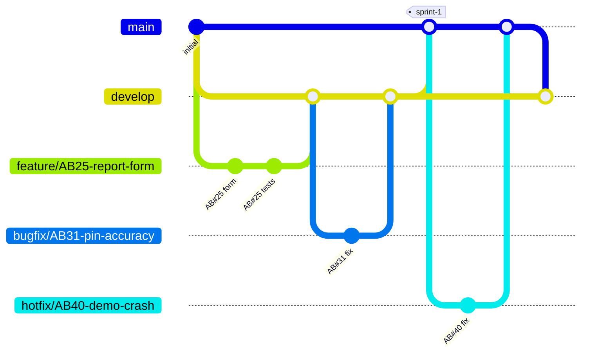

# Branching strategy (Part 2, Task 1)

## Strategy: simplified Git Flow

| Branch | Purpose | Created from | Merges into |
|---|---|---|---|
| `main` | **Stable**: what we demonstrate at the end of each sprint. Tagged `sprint-1`, `sprint-2`… | – | – |
| `develop` | **Integration**: finished work for the current sprint | `main` | `main` at sprint end |
| `feature/AB<id>-<name>` | **Feature isolation**: one user story or task | `develop` | `develop` |
| `bugfix/AB<id>-<name>` | **Bug fixes** found during the sprint | `develop` | `develop` |
| `hotfix/AB<id>-<name>` | **Urgent fix** to `main` (e.g. just before a demo) | `main` | `main` and `develop` |

Branch names include the work-item number so every branch can be traced back to Azure Boards.

## Why this strategy

* **We demo at the end of each sprint.** `main` only receives tested work from `develop`, so there is always a working version to present, even while new features are half-finished. This is the *stabilisation* purpose in the brief.
* **Four people work in parallel.** Each person works on their own feature branch, so unfinished code never breaks someone else's work (*feature isolation*).
* **Bugs have a clear route.** Normal bugs go through `develop`. A bug found in the demo version is fixed with a `hotfix` branch without bringing in unfinished features.
* **Every change is reviewed and built.** All merges into `develop` and `main` go through a pull request with the CI pipeline as a required check.

**Alternatives considered**

* *Trunk-based development* (everyone commits to `main` behind feature flags) needs very mature automated testing and feature flags. It's risky for a new team with a demo deadline.
* *Full Git Flow* with separate `release/*` branches adds a step we don't need: our "release" is the sprint demo, so merging `develop` into `main` and tagging it is enough.
* *GitHub Flow* (only `main` + feature branches) has no separate integration branch, so `main` would change every time a PR is merged, including just before a demo.

## Merge rules

* **Feature/bugfix → develop:** *squash merge*. Each work item becomes one clean commit, which keeps the history readable.
* **develop → main:** *merge commit* at the end of the sprint, then tag it: `git tag sprint-1 && git push --tags`.
* **hotfix → main:** merge commit, then merge `main` back into `develop` so the fix isn't lost.
* Delete the source branch after merging (tick the box in the pull request).

## Branch policies (check-in policies) to set in Azure DevOps

*Repos → Branches → `…` next to `main` (and again for `develop`) → Branch policies*:

| Policy | Setting | Why |
|---|---|---|
| Require a minimum number of reviewers | 1 reviewer, **"Allow requestors to approve their own changes" off**, reset votes on new pushes | Every change gets a code review |
| Check for linked work items | **Required** | Every change is traced to Azure Boards (Task 2) |
| Check for comment resolution | **Required** | Review comments must be dealt with |
| Limit merge types | develop: squash only · main: basic merge only | Matches the merge rules above |
| Build validation | Add the CI pipeline (`azure-pipelines.yml`), trigger automatic, policy **required** | Code that fails tests or analysis can't be merged |

Also turn on *Repos → Settings → Repository → Commit mention linking*, so `AB#123` in a commit message links the commit to work item 123.
